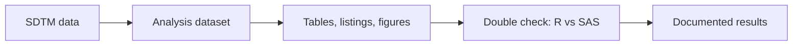

**Master's in Statistics** &nbsp;·&nbsp; Statistical Programming &nbsp;·&nbsp; Clinical Trials

&nbsp;

&nbsp;

## 🧬 ABOUT

I am a Statistics postgraduate working in **statistical programming and clinical research**. I build tables, listings and analyses from clinical trial data in **SAS and R**, following **CDISC SDTM / ADaM** standards.

My academic foundation in Statistics shapes how I approach data, from understanding distributions and spotting patterns to interpreting results and communicating findings.

- ✅ Checking every result twice: R against SAS, and my code against official datasets
- 📐 Understanding the statistics behind a number before reporting it
- 📝 Documenting the reasoning, the limits and the checks, not only the output
- 🎯 Open to **Statistical Programmer**, **Clinical SAS Programmer** and **Biostatistics** roles

> Grounded in statistics. Careful with data. Always learning.

## 🔄 HOW I WORK

## 🔬 AREAS OF INTEREST

<table>
<tr>
<td width="50%" valign="top">

### 📈 Statistical Analysis
- Descriptive statistics
- Probability & distributions
- Hypothesis testing
- Regression analysis
- Survival analysis

</td>
<td width="50%" valign="top">

### 🏥 Clinical Research
- Clinical trial data concepts
- CDISC SDTM / ADaM
- Tables, Listings & Figures (TLFs)
- Data validation and QC
- Safety and efficacy reporting

</td>
</tr>
</table>

## 🛠️ TOOLS & TECHNOLOGIES

| Category | Tools & concepts |
|:--|:--|
| Statistical Programming | SAS · R |
| Data Querying | SQL |
| R Ecosystem | dplyr · tidyr · survival |
| SAS Procedures | DATA Step · PROC SQL · MEANS · FREQ · GLM · REPORT · LIFETEST · PHREG |
| Clinical Data | SDTM · ADaM · TLFs |
| Statistics | Hypothesis Testing · ANOVA · Regression · Survival Analysis |
| Reporting | PROC REPORT · HTML and RTF tables · Excel |

## 📊 STATISTICS IN PRACTICE

| Concept | Where I used it |
|:--|:--|
| **Censoring** and survival curves | Kaplan–Meier: patients still alive at the end of follow-up still count |
| **Hazard ratios** and the proportional hazards check | Cox regression; ejection fraction showed a mild warning (p = 0.036) |
| **Hypothesis tests**: ANOVA, chi-square, Fisher's exact, log-rank | All three projects |
| **Denominators**: counting patients, not events | AE summary: a patient counts once per body system |
| **Population selection** | Safety population: treated patients only, Screen Failures excluded |
| **Confidence intervals** and honest limits | Every result has its uncertainty and a Limitations section |

## 🚀 SELECTED PROJECTS

Hands-on projects in statistical programming and clinical data. Each one is done in R and SAS, with the results checked against each other.

<table>
<tr>
<td width="50%" valign="top">

### 👥 01. Baseline Demographics

**Clinical Data | SAS + R**

A treatment-arm-wise baseline demographics summary using CDISC pilot ADSL data.

**Explores**
- Safety population selection
- Age, sex and race summaries
- PROC MEANS and PROC FREQ
- ANOVA and chi-square tests
- Cross-validation of R and SAS results

**Result:** R and SAS gave identical results (254 treated patients).

</td>
<td width="50%" valign="top">

### ⏳ 02. Heart Failure Survival Analysis

**Statistical Analysis | R + SAS**

A survival analysis of heart-failure patient records using time-to-event methods.

**Explores**
- Kaplan–Meier estimation
- Log-rank test
- Cox proportional hazards model
- Proportional hazards check
- Cross-validation of R and SAS results

**Result:** low ejection fraction linked to worse survival (log-rank p = 0.002); R and SAS matched.

</td>
</tr>
<tr>
<td colspan="2" valign="top">

### ⚠️ 03. Adverse Events Summary & Listing

**Clinical Safety Data | SAS + R**

A treatment-emergent adverse event summary and listing, built from SDTM data and checked against the official ADAE.

**Explores**
- Building the AE analysis dataset from SDTM
- Treatment-emergent flag with a 30-day window
- Summary table, patient listing and Fisher's exact test
- PROC SQL, PROC REPORT and double-programming QC

**Result:** my flag matched the official ADAE on all 1,191 events; 94% of high-dose patients had at least one treatment-emergent AE, against 76% on Placebo.

</td>
</tr>
</table>

## 🌱 CURRENT LEARNING

| Focus | Direction |
|:--|:--|
| SAS | Base SAS programming certification |
| R | Statistical analysis and reporting |
| SQL | Queries, joins and aggregations |
| Clinical Programming | SDTM / ADaM dataset
